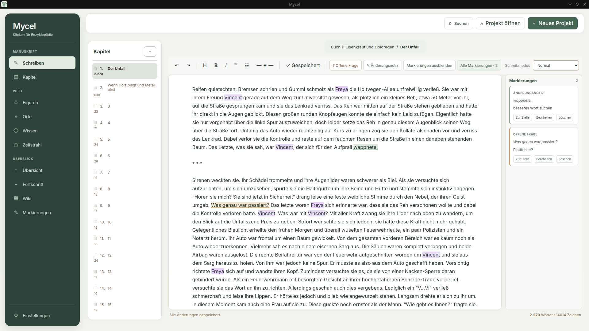
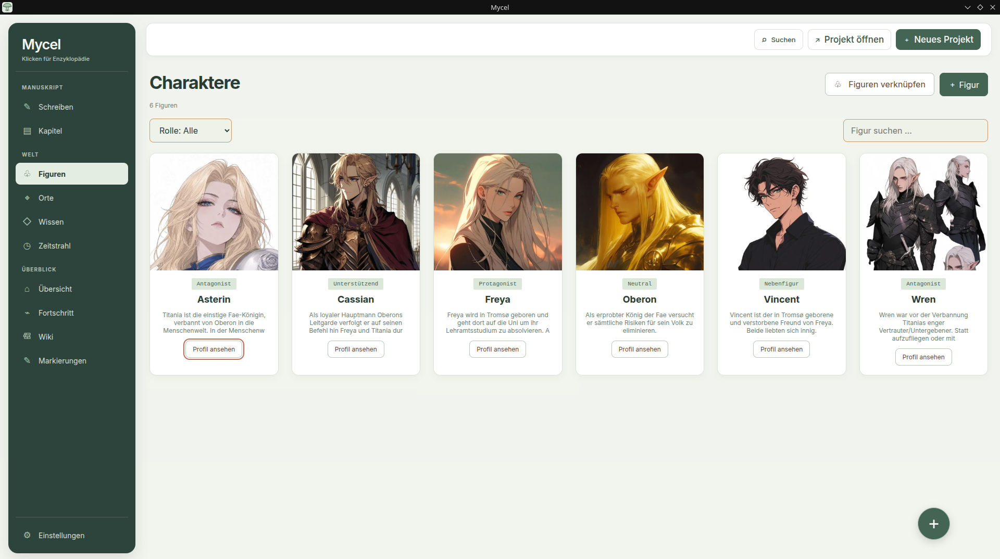
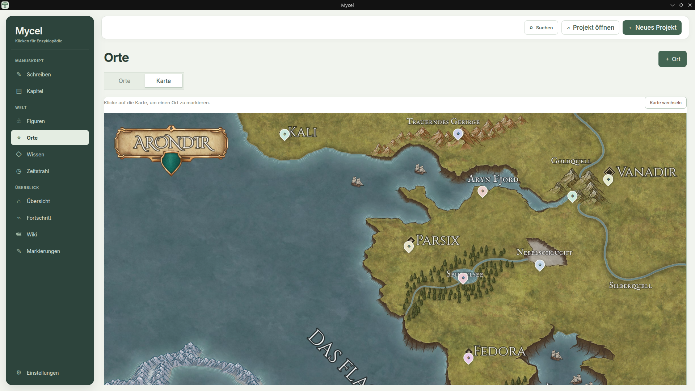
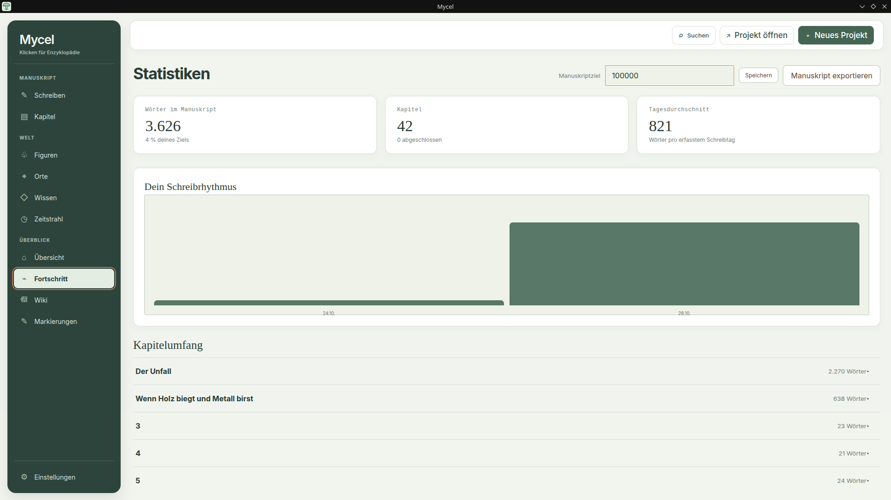
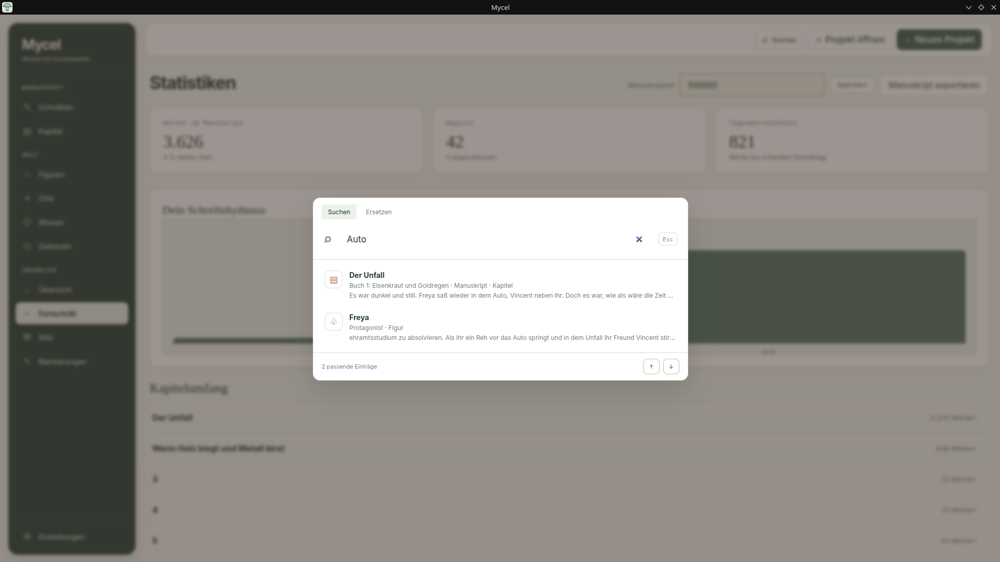
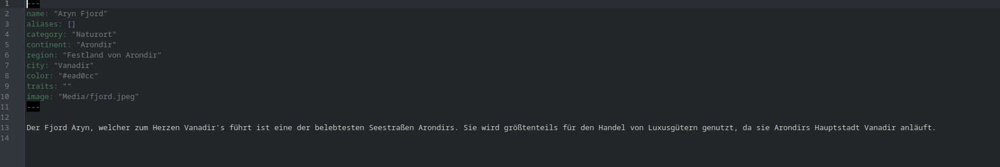

<!-- BILD 1 (Banner/Logo): Dein vorhandenes mycel-icon.svg oder mycel.png.
     Optional: ein breites Banner (ca. 1280x320) unter docs/images/banner.png -->
<p align="center">
  
</p>

<h1 align="center">Mycel</h1>

<p align="center">
  <strong>A calm, local-first writing suite for novelists.</strong><br>
  Write chapters, build your world, and watch your story grow — in plain Markdown files that stay yours.
</p>

<p align="center">
  
  
  
  
</p>

<!-- BILD 2 (Hero-Screenshot): Hauptansicht mit geöffnetem Kapitel, links die Seitenleiste
     (Kapitel/Charaktere/Orte/Wissen), rechts der Text. Das ist das wichtigste Bild.
     Datei: docs/images/hero.png (ca. 1600x1000, am besten mit dem Testprojekt aufgenommen) -->
<p align="center">
  
</p>

---

## Why Mycel?

Most writing tools either bury your manuscript in a proprietary format or leave your worldbuilding scattered across a dozen documents. Mycel keeps everything in one place and stays out of your way:

- **Your files, your folder.** Every chapter, character, place, and knowledge entry is an ordinary Markdown file you can open anywhere.
- **No account, no cloud.** Nothing is uploaded. Sync and backup are up to you.
- **Built for long fiction.** Volumes, statuses, aliases, hierarchies, and links between everything — made for books with a big cast and a big world.

## Features

### Chapters
Write and organize chapters by volume, status, and order.

### Characters
Profiles with roles, aliases, descriptions, portraits, and relationships.

<!-- BILD 3 (Charakter-Ansicht): Ein ausgefülltes Charakterprofil mit Porträt, Aliasen und Beziehungen.
     Datei: docs/images/characters.png -->
<p align="center">
  
</p>

### Places
Organize places by category and hierarchy (world → region → city → building), with images and descriptions.

<!-- BILD 4 (Orte-Ansicht): Orte-Hierarchie als Baum plus ein Ort mit Bild.
     Datei: docs/images/places.png -->
<p align="center">
  
</p>

### Knowledge
Flexible entries for races, religions, magic systems, objects, and anything else your world needs — connected to characters, places, and other entries.

### Automatic linking
Names and aliases of characters, places, and knowledge entries are linked automatically wherever they appear in your manuscript.

### Progress tracking
Track manuscript word count, daily writing, and progress toward your word goal.

<!-- BILD 6 (Fortschritt): Die Statistik-/Zielansicht mit Wortzahl, Tagesfortschritt und Zielbalken.
     Datei: docs/images/progress.png -->
<p align="center">
  
</p>

### Project-wide search
Search the whole project and replace text throughout the manuscript.

<!-- BILD 7 (Suche, optional): Suchfeld mit Ergebnisliste über Kapitel und Profile.
     Datei: docs/images/search.png -->
<p align="center">
  
</p>

## Quick start

**Requirements:** [Node.js](https://nodejs.org/) 22.12 or newer.

```bash
git clone https://github.com/VaIenx/Mycel.git
cd Mycel
npm install
npm start
```

Then create a new project, pick a parent folder, and start writing. To look around first, open the included demo project (see below).

### Demo project

`Mycel-Testprojekt/` ships with sample chapters, linked characters, hierarchical places with images, and connected knowledge entries. Open that folder in Mycel to explore every feature with real content.

### Build for Linux

Standalone desktop app:

```bash
npm run build:linux
```

The app folder and a desktop entry are created in `dist/Mycel-linux-x64`. The shortcut starts Mycel directly, no `npm start` needed.

RPM package (Linux x86_64, requires `rpmbuild`):

```bash
npm run build:rpm
```

The RPM lands in `dist/` with a system application shortcut and icon.

## How your project is stored

Creating a project makes a folder with this structure:

```
My Novel/
├── Chapters/             One Markdown file per chapter
├── Characters/           One Markdown profile per character
├── Places/               One Markdown profile per place
├── Knowledge/            One Markdown profile per knowledge entry
├── Media/                All your images in one place
└── .mycel/
    └── project.json      Organization, profiles, goal, and daily totals
```

Everything stays readable and editable outside Mycel. `.mycel/project.json` only holds organization and progress data, never your manuscript text. **To back up a project, copy the whole folder.**

<!-- BILD 8 (optional, aber stark): Screenshot des Dateimanagers mit geöffnetem Projektordner,
     das zeigt, dass alles normale .md-Dateien sind. Datei: docs/images/files.png -->
<p align="center">
  
</p>

## Privacy

Mycel works with local folders and needs no account. It never uploads your manuscript. Your files stay on your computer unless you move or sync them yourself.

## Roadmap

- [ ] Scene planning with point of view, purpose, and short summary
- [ ] Chapter snapshots to compare and restore earlier drafts
- [x] Export to DOCX, PDF, and EPUB with configurable formatting
- [ ] Reorder chapters and scenes directly in the outline
- [ ] Project backups with a simple restore flow

## Development

Mycel is built with Electron and plain HTML, CSS, and JavaScript — no framework. See [BUILDING.md](BUILDING.md) for the source layout and development commands.

Issues and ideas are welcome.

## License

Released under the [MIT License](LICENSE) by [Valenx](https://github.com/VaIenx).
